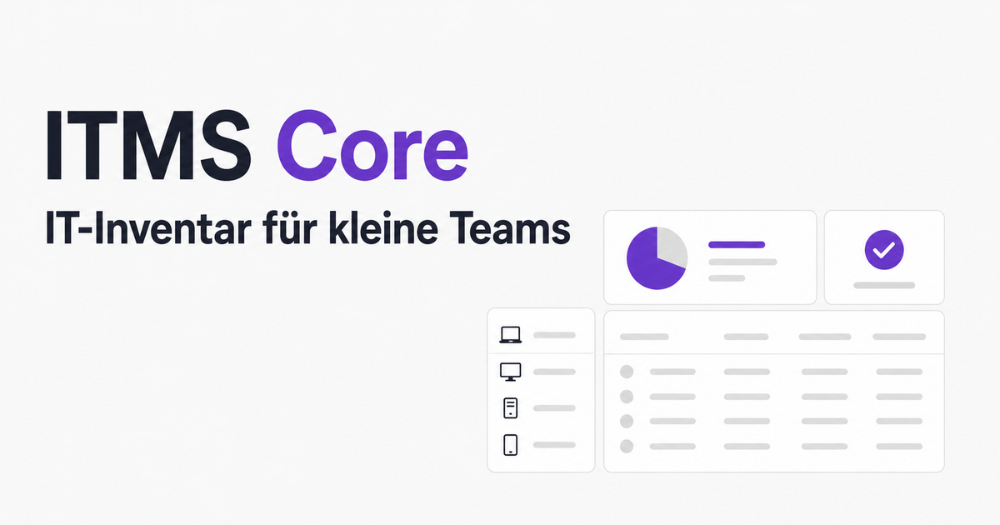
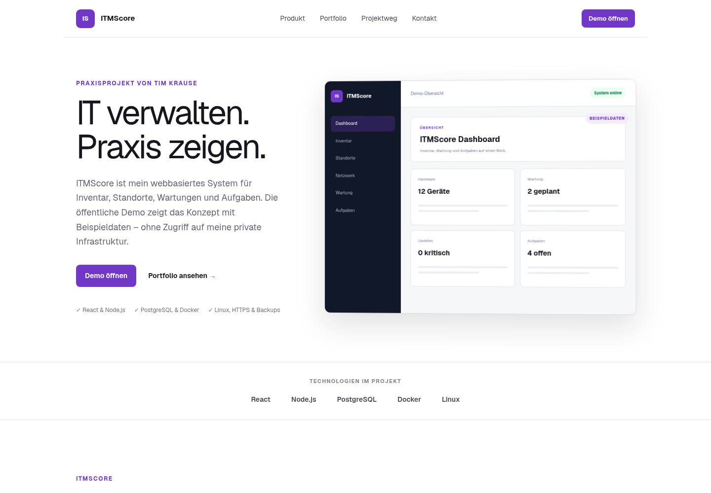
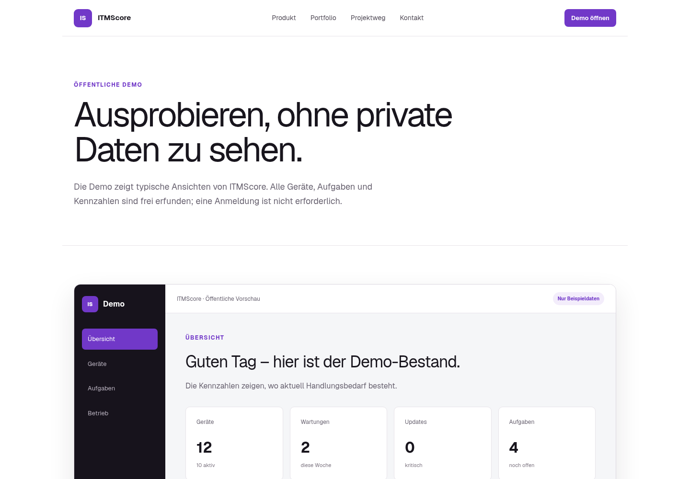
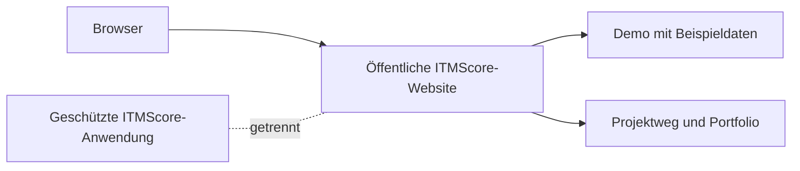

<p align="center">
  <a href="https://itmscore.de/">
    
  </a>
</p>

<h1 align="center">ITMScore – öffentliche Projektseite</h1>

<p align="center">
  Präsentation, interaktive Demo und technisches Portfolio rund um mein IT-Management-Praxisprojekt.
</p>

<p align="center">
  <a href="https://itmscore.de/"><strong>Projektseite</strong></a> ·
  <a href="https://itmscore.de/demo"><strong>Demo ausprobieren</strong></a> ·
  <a href="https://itmscore.de/referenz"><strong>Projektweg</strong></a> ·
  <a href="https://itmscore.de/portfolio"><strong>Portfolio</strong></a>
</p>

<p align="center">
  <a href="https://github.com/tkrauseweb/itmscore-website/actions/workflows/ci.yml"></a>
  
  
  
  
</p>

## Über das Projekt

ITMScore ist ein webbasiertes System für Inventar, Standorte, Wartungen und Aufgaben. Das Gesamtprojekt verbindet Webentwicklung, Systemintegration, sicheren Serverbetrieb und technische Dokumentation.

Dieses Repository enthält bewusst **nur die öffentliche Projekt- und Portfolioseite**. Die geschützte ITMScore-Anwendung, produktive Daten, Zugangsdaten und interne Infrastrukturkonfigurationen sind nicht Bestandteil dieses Repositorys.

## Einblicke

| Projektseite | Interaktive Demo |
| --- | --- |
| [](https://itmscore.de/) | [](https://itmscore.de/demo) |

Die Demo arbeitet ausschließlich mit frei erfundenen Beispieldaten, benötigt keine Anmeldung und stellt keine Verbindung zur produktiven Installation her.

## Inhalte der Website

- **Öffentliche Demo:** interaktive Ansichten für Übersicht, Geräte, Aufgaben und Betrieb
- **Produktvorstellung:** Geräteinventar, Wartungsplanung, Aufgaben, Updates und Berichte
- **Projektweg:** Anforderungen, Umsetzung, Tests, Betrieb und Dokumentation
- **Architektur:** verständliche Darstellung von Anwendung, Datenbank, HTTPS und Backups
- **Portfolio:** praktische Kenntnisse in Linux, Netzwerken, Virtualisierung, Docker und Webentwicklung
- **Kontakt:** lokales Öffnen einer vorbereiteten E-Mail – ohne Speicherung von Formulardaten

## Technischer Aufbau

Die öffentliche Website ist eine eigenständige Präsentationsschicht. Sie zeigt das Konzept, ohne Zugriff auf die geschützte Anwendung oder private Infrastruktur zu ermöglichen.



**Website-Stack**

- TypeScript 5.9 und React 19
- Next.js-kompatible App-Struktur mit Vinext und Vite 8
- serverseitige Metadaten, Sitemap und `robots.txt`
- responsive Oberfläche mit eigenem CSS
- Bereitstellung über OpenAI Sites und Cloudflare-Werkzeuge

Die auf der Website beschriebene geschützte Anwendung verwendet React, Node.js, PostgreSQL, Docker und Linux. Ihr Quellcode liegt nicht in diesem Repository.

## Lokal ausführen

### Voraussetzungen

- Node.js `>=22.13.0`
- npm

### Installation

```bash
git clone https://github.com/tkrauseweb/itmscore-website.git
cd itmscore-website
npm ci
npm run dev
```

Die Entwicklungsumgebung ist anschließend unter `http://localhost:3000` erreichbar.

## Verfügbare Befehle

| Befehl | Aufgabe |
| --- | --- |
| `npm run dev` | lokale Entwicklungsumgebung starten |
| `npm run lint` | Quellcode mit ESLint prüfen |
| `npm run build` | produktiven Build erstellen |
| `npm run start` | erstellte Anwendung starten |

## Projektstruktur

```text
app/                 Seiten, Layout, Demo und Komponenten
data/                zentral gepflegte Portfolio-Inhalte
public/              Icons, Vorschaubilder und README-Screenshots
.openai/hosting.json Hosting-Bindung der Projektseite
```

## Datenschutz und Sicherheit

- keine echten Geräte-, Benutzer- oder Betriebsdaten in der Demo
- keine Verbindung zwischen Demo und produktiver Installation
- keine Speicherung von Kontaktformular-Eingaben
- keine Zugangsdaten oder produktiven Konfigurationen im Repository
- öffentliche Darstellung technischer Konzepte ohne interne Adressen oder Geheimnisse

## Status

Die Projektseite und ITMScore werden fortlaufend weiterentwickelt. Aktueller Stand und öffentliche Demo: [itmscore.de](https://itmscore.de/)
